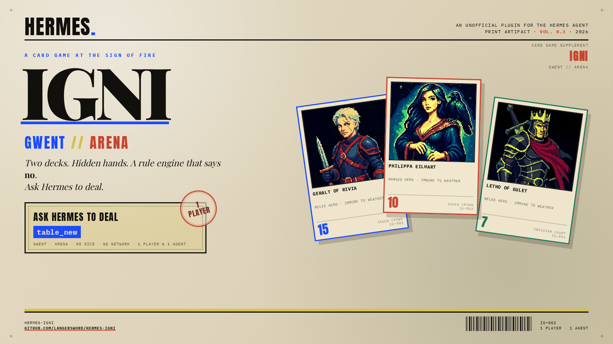
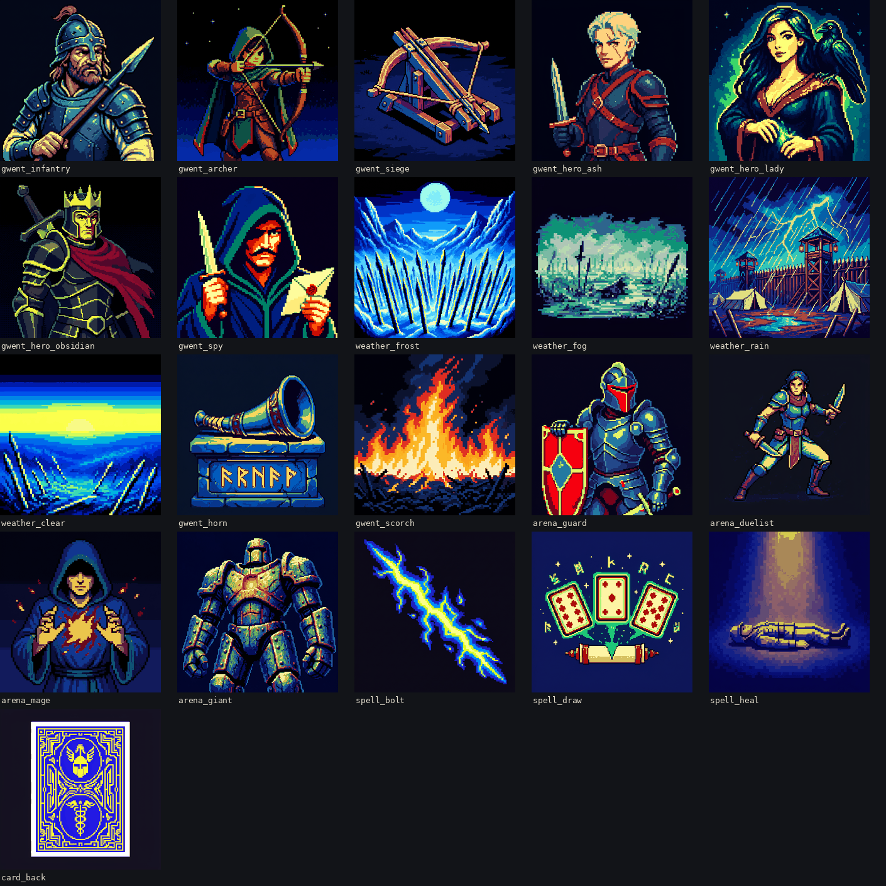

# Igni

**Card games at the sign of fire.** Two real, deterministic engines — a Gwent-shaped
row war and a Hearthstone-shaped mana duel — played against a rule-based
opponent that keeps its hand hidden. Play from chat with the agent, from a live
TUI scoreboard, or from a full desktop page with clickable cards.

The plugin is **Igni**; `table` is its game surface (`table_*` tools,
`/table`, `hermes table`). No API keys, no network, stdlib only on the engine side.




```text
GWENT · round 2/3 · your move

Opponent · Nilfgaard · score 26 · rounds 1 · hand 6 · deck 4
  melee  ▸ Impera Brigade 4 · Alba Pikemen 3          = 7
  ranged ▸ Black Infantry Archer 6                    = 6
  siege  ▸ Mangonel 6 · Menno Coehoorn 10             = 16
  hand    ▸ 6 hidden card(s)

You · Northern Realms · score 16 · rounds 0 · hand 7 · deck 4
  melee  ▸ Blue Stripes Commando 4 · Redanian Elite 5 = 9
  ranged ▸ —                                          = 0
  siege  ▸ Ballista 6                                 = 6

Weather: Biting Frost (melee)
Rounds won: you 0 — opponent 1

HAND
  [1] Ballista · siege · 6
  [2] Commander's Horn · special · double a row (add row)
  [3] Sigismund Dijkstra · spy · 4 · played to the enemy, draw 2
  ...

Your move: play <hand#> [row] for a horn, or pass.
```

## Why this exists

A game is a better demo of an agent than another dashboard. It has real state, a
visible opponent, hidden information, and a rule engine that says *no*. Igni
puts that inside Hermes without turning the agent into a rules lawyer: the
engine validates every move, the agent relays yours, and the opponent's hand
never leaves the process.

## Modes

### Gwent — best of three, rows and weather

- Rows: melee, ranged, siege.
- Win two rounds. A round ends when both sides pass; a tie awards it to both.
- Weather sets every **non-hero** unit on one row to 1, for both sides.
- Commander's Horn doubles one of your rows. Clear Weather removes all weather.
- Spies join the enemy row and draw you two cards.
- Scorch destroys the strongest non-hero unit(s) on the board — both sides.
- Heroes are immune to weather. Hands and draw piles carry between rounds; the
  board, weather and horns clear.

### Arena — a mana duel to zero

- 30 health, mana 1→10, refill each turn, draw one.
- Minions have summoning sickness unless they have Charge.
- Taunts must be attacked first; Divine Shield absorbs the first hit.
- Battlecries: draw, heal, or damage all enemy minions.
- Empty deck deals rising fatigue damage.

The rules engines and illustrations are original. Gwent mode is an unaffiliated
fan homage to the row-war mini-game; its character names belong to their
owners. Arena mode is original. No assets from a commercial game are used.

## Art

- **Cover:** a recent-Nous-style print artifact — newsprint, halftone, cobalt /
  vermilion / acid inks, registration marks, a mail-order coupon and a fanned
  pixel hand. Source in `cover/cover.html`; render with
  `python3 scripts/render_cover.py`.
- **Cards:** 256 px, 24-colour pure pixel art in `art/`. Every card key maps to
  an archetype print; the frame, title and stats keep each card distinct. Rebuild
  with `python3 scripts/build_card_art.py`; contact sheet in
  `docs/card-art-grid.png`.
- **Desktop:** cards render with `image-rendering: pixelated`, a hard 2 px frame
  and a scanline panel. The TUI stays typographic — the board is the art there.




## Play from chat

The tools are `table_new`, `table_play`, `table_state`, `table_rules`.

```text
you    play gwent
hermes ┌──────────────────────────────┐
       │ table_new { mode: gwent }     │
       └──────────────────────────────┘
       [board, your move]

you    play 3
hermes ┌──────────────────────────────┐
       │ table_play { action: play,    │
       │              card: 3 }        │
       └──────────────────────────────┘
       You play Blue Stripes Commando (4) to melee.
       Opponent plays Impera Brigade (4) to melee.
       [new board]
```

Arena moves: `play <hand#>` (add a target for a damage spell),
`attack <your board#> <enemy board#|hero>`, `end turn`.
Gwent moves: `play <hand#>`, `play <hand#> <row>` for the horn, `pass`.

The agent is the referee, not the player: it asks for your move, relays it
exactly, and never reveals the hidden hand.

## Slash command

```text
/table                     show the active board
/table rules [mode]        rules + the full card pool
/table new [gwent|arena] [seed]
/table install-widget      put the TUI scoreboard in place
```

## Terminal

The CLI is a thin shim over the same engine, so it can also serve as the demo:

```bash
python3 table_cli.py demo gwent --seed 7     # AI vs AI, full transcript
python3 table_cli.py demo arena --seed 3
python3 table_cli.py play gwent              # play in this terminal
python3 table_cli.py rules arena
```

`hermes table …` is wired too when the plugin runs in-process; under
`plugins.isolation: host` the host skips CLI subcommands, so use the Python
entry point above.

## TUI

`tui/table-board.mjs` is an ambient scoreboard. `table_new` installs it into
`$HERMES_HOME/tui-widgets/` on first use; `hermes table install-widget` and
`/table install-widget` do the same by hand.

```text
/table-board
```

It reads the hand-free snapshot at `$HERMES_HOME/igni/board.json` once a
second. It never includes the opponent's cards.

## Desktop

The same package ships the desktop half:

```text
desktop/plugin.js       full page at /table, clickable cards, sidebar nav row,
                        ⌘K "Igni: open the card table", statusbar chip
dashboard/plugin_api.py /api/plugins/igni/{state,new,move,rules,art/{key}}
```

The page plays both games without the chat agent: click a card, pick a row or
target, summon, attack, pass. It polls the backend and also subscribes to
`plugin.igni.moved`.

The desktop half loads by default for this package; turn it off in
**Capabilities → Plugins → Igni** if you don't want it. The Python half
is gated separately by `hermes plugins enable igni`.

## Install

From this checkout:

```bash
python3 scripts/sync_plugin.py
hermes plugins enable igni
hermes table install-widget
```

Then start a new session (tools and the prompt section land next session; hooks
and slash commands hot-reload). Reload the TUI widgets with `/widgets-reload`
and open `/table-board`. In the desktop app, rescan plugins and open Igni.

Once the repo is published, `hermes plugins install LangerSword/hermes-igni`
installs the same folder.

## Verify

```bash
python3 -m unittest discover -s tests -v   # 29 behaviour tests
python3 smoke_test.py --show               # both modes, 20 seeds, plus a board
python3 smoke_load.py                      # real register() + tool dispatch
hermes plugins validate .                  # manifest + capability probe
```

What the tests prove: deck sizes, weather/horn/hero scoring, spy draw, scorch,
round ties and match draws, mana/summon/taunt/lethal, AI turns finishing,
AI pass discipline, hidden-hand boundaries in `public_view`/snapshot/tools,
tool errors as JSON, widget install, art coverage, persistence, backend routes,
and AI-vs-AI termination on every seed.

## Layout

```text
__init__.py          register(): tools, /table, hermes table, prompt section
table_cards.py       original card pools, deck builders, rules text, art map
table_common.py      GameError + side helpers
table_gwent.py       row war: scoring, weather, spies, horns, scorch, AI
table_arena.py       mana duel: combat, taunts, spells, battlecries, AI
table_render.py      chat board, structured public view, widget snapshot
table_engine.py      mode dispatch + the opponent's reply inside one call
table_store.py       profile-scoped state, atomic snapshot, widget install
table_tools.py       the four tool specs and handlers
table_cli.py         /table, hermes table, standalone CLI, interactive play
tui/table-board.mjs  ambient TUI scoreboard
desktop/plugin.js    desktop page: pixel cards, click-to-play, /art cache
dashboard/           FastAPI router for state, moves and card art
art/                 256px / 24-colour pixel card art (WebP)
cover/cover.html     the print-artifact cover source
assets/fonts/        Anton / Playfair / IBM Plex / Press Start / VT323
docs/                cover, desktop screenshot, card contact sheet
tests/               stdlib unittest
scripts/             sync, art build, cover render, desktop probe
```

State lives in the plugin data directory (one active table per profile) and in
`$HERMES_HOME/igni/board.json` for the widget. Both are JSON and atomic.

## Limits

- The AI is a heuristic opponent, not a tournament engine. It plays legal,
  tempo-aware moves; it will not surprise you with a meta deck.
- No multiplayer, no network, no persistence beyond the active table.
- The two modes are compact by design: a readable ruleset that fits in a tool
  result beats a card database.

## License

MIT. See [LICENSE](LICENSE).
